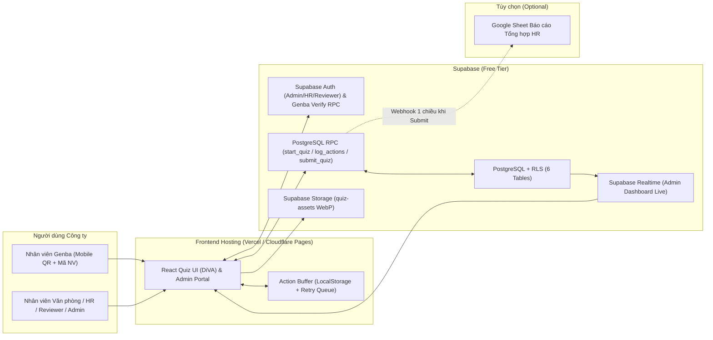
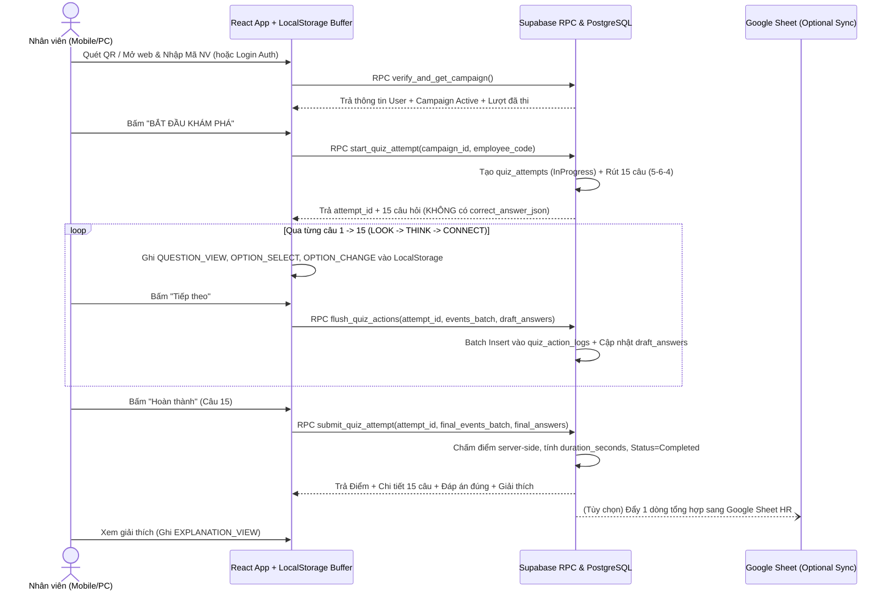

# 01. Kiến trúc Hệ thống (Supabase Architecture & Google Sheets Option)

## 1. Tổng quan Kiến trúc (Đơn giản, Nhanh, Không cần Backend Server riêng)

Thay vì dựng một backend riêng hoặc dùng SharePoint phức tạp, hệ thống sử dụng mô hình **Serverless Jamstack**:
- **Frontend**: **React + TypeScript + Vite + Tailwind CSS** deploy miễn phí trên **Vercel** hoặc **Cloudflare Pages** (Edge CDN toàn cầu, không giới hạn băng thông tải trang).
- **Backend / Database / Auth / Storage / Realtime**: **Supabase (Free Tier)** xử lý toàn bộ qua PostgreSQL, RLS Policies, Storage Bucket và PostgreSQL RPC Functions.
- **Tùy chọn đồng bộ phụ**: **Google Sheets Sync (1 chiều)** qua Supabase Edge Function nếu bộ phận HR muốn xem thêm file Sheet tổng hợp kết quả theo thói quen.

---

## 2. Tại sao chọn Supabase (Free) thay vì lưu trực tiếp lên Google Sheets?

1. **Tốc độ & Chịu tải giờ cao điểm**:
   - Google Sheets API giới hạn khoảng ~60 write requests/phút/user và xử lý tuần tự theo lock file; nếu 100 công nhân cùng bấm làm bài vào giờ nghỉ trưa sẽ rất dễ nghẽn hoặc văng lỗi `429`.
   - Supabase dùng PostgreSQL thật, xử lý hàng trăm kết nối đồng thời trong tích tắc và hỗ trợ Insert hàng chục nghìn dòng `quiz_action_logs` không bị chậm dần.
2. **Bảo mật Đáp án & Phân quyền RBAC thực thụ**:
   - Nếu lưu câu hỏi & đáp án trên Google Sheets rồi cho Web App đọc, rất dễ lộ đáp án hoặc chậm qua Google Apps Script (cold start 1.5–3s).
   - Trên Supabase, bảng `questions` khóa bằng **Row Level Security (RLS)**. Thí sinh chỉ lấy được đề thi (không có đáp án) qua hàm `start_quiz_attempt()`, và chấm điểm hoàn toàn trong Database qua `submit_quiz_attempt()`.
3. **Lưu trữ Hình ảnh & Realtime Dashboard**:
   - Supabase Storage (`1 GB` miễn phí) lưu ảnh cắt từ Poster Vision 2035 gọn nhẹ; Supabase Realtime đẩy dữ liệu mới về Dashboard Admin ngay khi có người nộp bài.
4. **Giải pháp Hybrid nếu HR vẫn thích Google Sheets**:
   - Không dùng Google Sheets làm database chính, mà chỉ dùng như **bảng báo cáo đầu ra (Read-only mirror)**: mỗi khi có lượt nộp bài hoàn tất (`submit_quiz_attempt`), Supabase Database Webhook / Edge Function có thể đẩy 1 dòng tóm tắt (`Mã NV`, `Họ tên`, `Phòng ban`, `Điểm`, `Thời gian`, `Hợp lệ`) sang Google Sheet của HR!

---

## 3. Luồng Xử lý Đời sống Một Lượt Làm bài (End-to-End Sequence)

